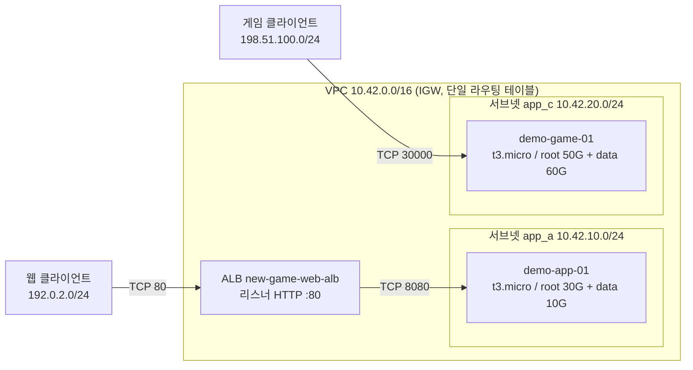
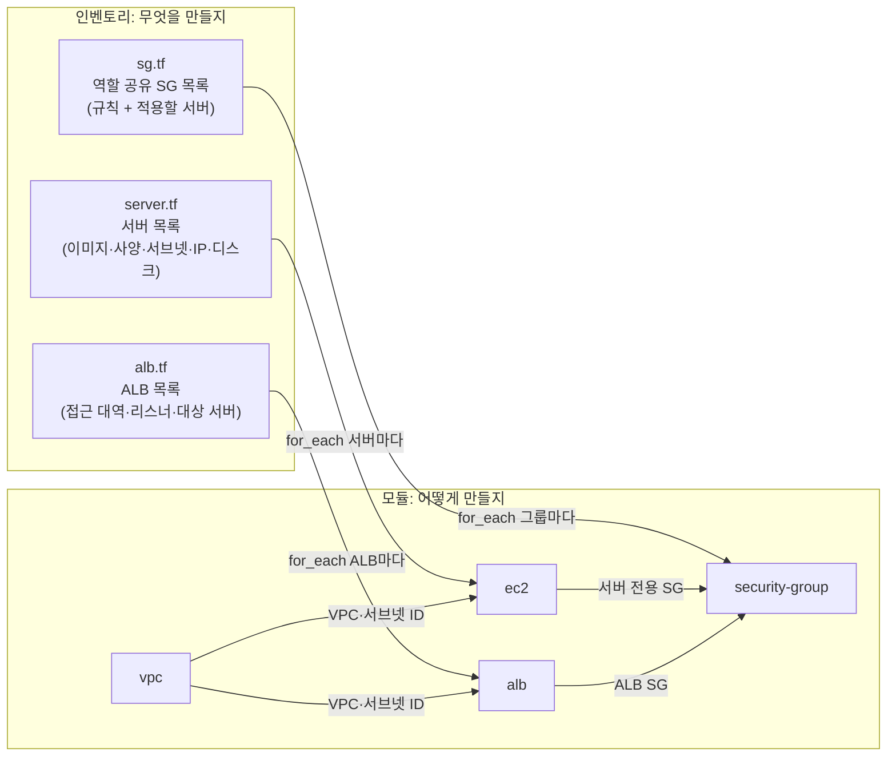
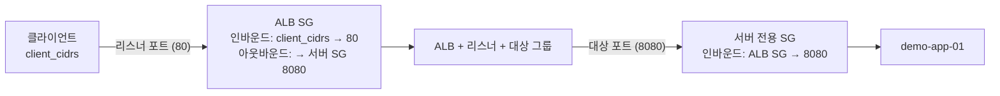
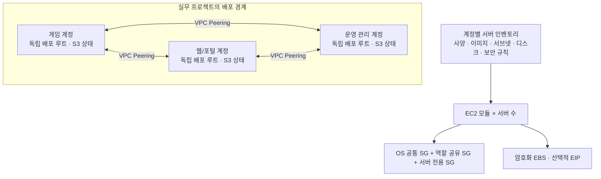

# Terraform 기반 해외 게임 서비스 AWS 인프라 표준화

게임 서비스용 **Windows·Linux EC2 서버 수십~수백 대를 같은 기준으로 만들고, 첫 부팅 시 OS 초기 설정까지 자동으로 끝내는** Terraform 구성입니다.

실무에서는 AWS 계정 3개에 서버 약 100대를 이 구조로 구축했습니다. 이 저장소는 그 설계를 설명하기 위해 **모듈 4개 + 더미 서버 2대 + ALB 1대**로 축소한 공개용 예제입니다. 서버명·IP·AMI·접근 대역은 모두 예시 값입니다.

> **3줄 요약**
> 1. 서버를 만드는 **방법**은 모듈(`modules/`)이 알고, **무엇을** 만들지는 인벤토리 파일(`server.tf`·`sg.tf`·`alb.tf`)에 적습니다.
> 2. 서버를 한 대 추가하려면 `server.tf`에 항목 하나를 추가하면 됩니다. 네트워크·보안 그룹·디스크·초기 설정은 모듈이 같은 기준으로 붙입니다.
> 3. 보안 그룹은 **OS 공통 → 역할 공유 → 서버 전용** 3계층으로 나누어, 반복 규칙은 재사용하고 서버별 차이만 따로 적습니다.

## 1. 이 저장소가 만드는 것

`new_game_project/`를 배포하면 아래 구성이 만들어집니다.



| 구성 요소 | 개수 | 어디서 정의하나 |
|---|---|---|
| VPC, 서브넷 2개, IGW, 라우팅 테이블 | 1세트 | `main.tf` → `vpc` 모듈 |
| EC2 서버 (전용 SG, 암호화 EBS 포함) | 2대 | `server.tf` → `main.tf`의 `ec2` 모듈 호출 |
| OS 공통 SG (`Linux_Common`) | 1개 | `main.tf` → `security-group` 모듈 |
| 역할 공유 SG (`game_service`) | 1개 | `sg.tf` → `security-group` 모듈 |
| ALB, 리스너, 대상 그룹, ALB SG | 1세트 | `alb.tf` → `alb` 모듈 |

두 서버는 같은 EC2 모듈로 만들지만 역할이 다릅니다. `demo-app-01`은 ALB 뒤의 웹 서버이고, `demo-game-01`은 게임 포트를 직접 여는 게임 서버입니다.

| 예제 서버 | 게임용 공유 SG | ALB 대상 그룹 |
|---|---|---|
| `demo-app-01` | 적용 안 함 | 등록 |
| `demo-game-01` | 적용 | 등록 안 함 |

## 2. 핵심 아이디어: "무엇을"과 "어떻게"의 분리

AWS Console에서 서버를 만들면 네트워크·보안 규칙·디스크·OS 초기 설정을 서버마다 반복해야 하고, 서버마다 설정이 조금씩 달라지기 쉽습니다. 이 구성은 그 반복 절차를 모듈로 묶고, 서버별 차이만 인벤토리에 적도록 나눴습니다.



### 서버 한 대 추가하기

[server.tf](new_game_project/server.tf)의 `local.servers`에 항목을 하나 추가하면 끝입니다.

```hcl
servers = {
  demo-app-01 = { ... }
  demo-game-01 = { ... }

  # 새 서버
  demo-game-02 = {
    image                  = "linux"        # main.tf의 images 별칭 → AMI
    subnet                 = "app_c"        # vpc 모듈의 서브넷 별칭
    private_ip             = "10.42.20.11"
    instance_type          = "t3.micro"
    root_volume_size       = 50
    data_volumes           = { "/dev/sdf" = { size = 60 } }
    allocate_eip           = false
    ingress_rules          = {}             # 이 서버만의 규칙
    egress_rules           = {}
    termination_protection = false
  }
}
```

이 항목 하나로 EC2 모듈이 다음을 같은 기준으로 만듭니다.

- 지정한 서브넷·사설 IP의 인스턴스 (IMDSv2 필수, 공인 IP 자동 할당 안 함)
- 암호화된 gp3 루트 볼륨과 추가 데이터 볼륨, 그리고 인스턴스 연결
- 서버 전용 보안 그룹 (`demo-game-02-server`)
- `allocate_eip = true`일 때만 EIP 할당
- 첫 부팅 시 실행할 `user_data` 스크립트 (호스트명 설정 + HTTP 데모 서비스)

게임용 공유 SG도 붙이려면 [sg.tf](new_game_project/sg.tf)의 `target_servers`에 서버명을 추가하고, ALB 뒤에 두려면 [alb.tf](new_game_project/alb.tf)의 `target_servers`에 추가합니다. 서버를 추가했다고 공유 SG나 ALB에 자동으로 편입되지는 않습니다. 존재하지 않는 서버명을 적으면 조용히 무시되지 않고 `plan` 단계에서 실패합니다.

## 3. 보안 그룹 3계층

한 서버에는 보안 그룹이 세 종류 겹쳐 붙습니다. 반복되는 규칙은 위 계층에서 한 번만 적고, 서버별 차이는 아래 계층에서만 적는 구조입니다.

| 계층 | 이름 (예제) | 누가 받나 | 어디서 정의 | 예제 규칙 |
|---|---|---|---|---|
| OS 공통 | `new-game-linux-common` | 모든 Linux 서버 | `main.tf` | 없음 (공통 정책을 넣는 자리) |
| 역할 공유 | `new-game-game_service` | `target_servers`에 적힌 서버 | `sg.tf` | TCP 30000 ← 198.51.100.0/24 |
| 서버 전용 | `<서버명>-server` | 그 서버 하나 | `server.tf`의 `ingress_rules`·`egress_rules` | ALB 모듈이 "ALB SG → 8080" 허용 규칙을 자동 추가 |

예를 들어 `demo-game-01`에는 OS 공통 SG + `game_service` SG + `demo-game-01-server` SG가 붙고, `demo-app-01`에는 OS 공통 SG + `demo-app-01-server` SG가 붙습니다.

AWS 보안 그룹은 붙어 있는 모든 그룹의 허용 규칙을 **합쳐서** 평가합니다. 한 계층에서 규칙을 빼는 것만으로는 다른 계층이 허용한 통신을 막을 수 없습니다.

## 4. ALB 연결은 대상 등록과 SG 규칙을 한 번에

[alb.tf](new_game_project/alb.tf)에 접근 대역·리스너·대상 서버를 적으면 `alb` 모듈이 아래를 함께 만듭니다.



- 대상 그룹 등록은 **리스너 × 서버 × 포트** 조합마다 만듭니다.
- SG 허용 규칙은 **서버 × 포트**마다 한 번만 만듭니다. 리스너가 여러 개여도 같은 백엔드 포트면 규칙이 중복되지 않습니다.
- 리스너에 `certificate_arn`을 주면 HTTPS 리스너가 됩니다. 예제는 HTTP만 사용합니다.

## 5. 모듈별 역할

| 모듈 | 만드는 것 | 호출부와 주요 입력 |
|---|---|---|
| [vpc](modules/vpc/main.tf) | VPC, 서브넷, IGW, 단일 라우팅 테이블 | [main.tf](new_game_project/main.tf): CIDR, 서브넷 별칭·AZ |
| [security-group](modules/security-group/main.tf) | SG 본체와 독립된 인바운드/아웃바운드 규칙 | [sg.tf](new_game_project/sg.tf): 규칙명, 포트, CIDR 또는 SG 참조 |
| [ec2](modules/ec2/main.tf) | 인스턴스, 서버 전용 SG, 암호화 EBS, 선택적 EIP | [main.tf](new_game_project/main.tf)가 [server.tf](new_game_project/server.tf)의 항목을 전달 |
| [alb](modules/alb/main.tf) | ALB, 리스너, 대상 그룹, 대상 등록, ALB↔서버 SG 규칙 | [alb.tf](new_game_project/alb.tf): 접근 대역, 대상 서버, 리스너·대상 포트 |

모듈 안에는 AWS 인증이나 리전을 고정하지 않습니다. Provider는 `new_game_project/versions.tf`에서 설정하고 하위 모듈이 상속합니다. 모든 `for_each` 키는 서버명·규칙명처럼 **생성 전에 알 수 있는 이름**을 씁니다. 인스턴스 ID처럼 생성 후에야 알 수 있는 값은 키로 쓰지 않습니다.

## 6. 실무 원본과 이 예제의 차이

실무에서는 게임·웹/포털·운영 관리 3개 계정을 각각 독립된 배포 루트와 S3 원격 상태로 분리하고, VPC 피어링으로 연결했습니다. 계정마다 같은 모듈 구조를 적용해 약 100대를 구축했습니다.



이 공개 예제는 그중 **계정 하나 안의 구조**만 재현합니다.

| 구분 | 공개용 처리 |
|---|---|
| 계정 3개, VPC 피어링, S3 원격 상태 | 계정 1개, 로컬 상태로 축소. 피어링·원격 상태 미포함 |
| 계정별 모듈 복사본 | 루트 `modules/`의 공통 모듈 하나로 통합 (공개용 리팩터링) |
| 서버 약 100대 | 더미 서버 2대 |
| Windows·Linux 전체 초기화 스크립트 | 비밀값 없는 Linux 예시 하나만 제공 |
| 운영 자격 증명, AD 설정, 백업 정책, VPN | 미포함 |
| ALB의 운영별 옵션 | HTTP 백엔드와 선택적 HTTPS 리스너로 축소 |
| 실계정·실서버·실제 IP | 더미 이름, 10.42.0.0/16 예제 대역, 문서용 외부 주소 192.0.2.0/24·198.51.100.0/24 |
| 실제 tfstate·plan·원본 Git 이력 | 미포함 |

원본에서는 계정별로 AWS 인증 프로파일과 S3 상태 저장소를 분리하고 상태 잠금으로 동시 변경을 막았습니다. 다만 프로파일 선택만으로 잘못된 계정 접근이 완전히 방지되지는 않으므로, 실제 배포 전에는 호출 계정 확인과 권한 경계 검증이 필요합니다.

## 7. 설계상 알아둘 점

- **네트워크는 단일 라우팅 테이블입니다.** 모든 서브넷이 IGW 기본 경로를 공유하므로 일반적인 퍼블릭/프라이빗 분리 구조가 아닙니다. 공인 IP 자동 할당을 끄고 EIP와 SG로 노출 범위를 제어합니다. NAT Gateway는 없습니다.
- **서버명은 리소스 주소의 일부입니다.** 서버명을 바꾸면 Terraform은 삭제 후 재생성으로 인식하므로 `plan`에서 확인해야 합니다. EBS 디바이스 키 변경도 같습니다.
- **추가 EBS는 생성·연결까지만 합니다.** OS 안에서의 포맷·마운트는 별도 작업입니다.
- **종료 방지는 모듈 기본값이 켜짐입니다.** 예제 서버는 정리하기 쉽도록 명시적으로 껐습니다.
- **ALB 대상 서버는 각자 전용 SG를 가진다고 전제합니다.** 여러 서버가 전용 SG 하나를 공유하면 ALB 모듈의 SG 규칙 집계 방식을 조정해야 합니다.
- **EBS 암호화는 백업이 아닙니다.** 백업 정책은 공개 예제에 포함하지 않았습니다. HTTP 데모 서비스도 운영용 애플리케이션 배포를 대체하지 않습니다.

## 8. 저장소 구성

```text
.
├── README.md
├── modules/                        # "어떻게 만들지"
│   ├── vpc/
│   ├── security-group/
│   ├── ec2/
│   └── alb/
└── new_game_project/               # "무엇을 만들지" + 배포 루트
    ├── main.tf                     # VPC·OS 공통 SG·EC2 모듈 호출
    ├── server.tf                   # 서버 인벤토리
    ├── sg.tf                       # 역할 공유 SG 인벤토리와 모듈 호출
    ├── alb.tf                      # ALB 인벤토리와 모듈 호출
    ├── versions.tf                 # Terraform·Provider 버전과 AWS 설정
    ├── variables.tf                # 리전·AMI 입력
    ├── outputs.tf                  # 서버 정보·ALB DNS 출력
    ├── terraform.tfvars.example    # 더미 입력 예시
    ├── templates/linux_init.sh.tpl # 첫 부팅 초기화 스크립트
    └── tests/portfolio.tftest.hcl  # AWS 배포 없는 모의 계획 테스트
```

`new_game_project/`가 유일한 배포 루트입니다. 이 디렉터리의 `.tf` 파일은 하나의 구성으로 함께 로드됩니다. 저장소 최상위와 `modules/`는 직접 배포하지 않습니다.

## 참고 문서

- [Terraform: 모듈 구성](https://developer.hashicorp.com/terraform/language/modules/develop)
- [Terraform: 모듈과 Provider](https://developer.hashicorp.com/terraform/language/modules/develop/providers)
- [AWS Provider 리소스 문서](https://registry.terraform.io/providers/hashicorp/aws/latest/docs)
