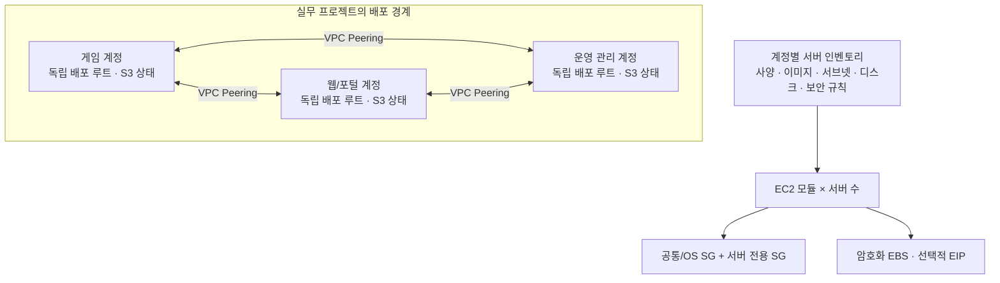

# Terraform 기반 해외 게임 서비스 AWS 인프라 표준화

다수의 **Windows·Linux EC2 서버를 일관된 기준으로 생성하고, OS 부팅 시 초기 설정까지 자동화**하기 위한 실무 프로젝트입니다. AWS Console에서 서버마다 네트워크·보안 규칙·디스크를 설정하고 OS 초기 설정을 반복하던 작업을 Terraform 코드와 초기화 스크립트로 관리하도록 구성했습니다.

핵심은 **반복되는 생성 절차는 모듈로 묶고, 서버별 차이는 인벤토리(inventory)로 관리**하는 것입니다. OS·서버 역할별 공통 정책은 적용할 서버를 지정해 재사용하고, 서버 전용 설정과 부팅 시 실행할 스크립트를 조합하는 방식으로 설계했습니다.

실제 프로젝트는 3개 AWS 계정에 약 100대 규모의 서버를 구축했습니다. 이 저장소는 그중 핵심 설계를 설명하기 위해 **4개 모듈과 더미 서버 구성을 연결하는 `new_game_project` 배포 루트**로 재구성했습니다. 원본의 `main.tf`·`server.tf`·`sg.tf`·`alb.tf` 파일 구성을 따르며, 초기화 스크립트는 비밀값 없는 Linux 예시만 제공합니다. 서버명·주소·AMI·클라이언트 대역은 모두 예시 데이터입니다.

## 문제와 개선

| 기존 문제 | 적용한 방식 |
|---|---|
| Console에서 계정별로 리소스를 개별 생성 | VPC·보안 그룹·EC2·ALB를 Terraform 모듈로 구성 |
| 서버 사양·디스크·보안 규칙의 설정 편차와 누락 가능성 | 서버별 설정을 이름 기반 맵으로 관리 |
| 서버 추가 시 같은 생성 절차 반복 | 인벤토리 항목을 추가하고 `for_each`로 모듈 호출 |
| 계정별 변경 범위와 상태가 섞일 가능성 | 원본에서 계정별 배포 루트·인증 설정·원격 상태 분리 |

**실무 적용 규모:** 게임·웹·운영 관리 AWS 3개 계정에 Windows·Linux 서버 약 100대를 Terraform으로 구축했습니다. 계정마다 같은 모듈 구조를 적용하고 운영 설정과 S3 상태를 분리했습니다.

## 구성 요약

서버를 추가할 때마다 리소스 생성 코드를 복사하는 대신, 서버의 사양과 역할을 정의하면 공통 모듈이 필요한 리소스를 생성하도록 구성했습니다. 자동화 범위는 EC2 생성뿐 아니라 네트워크·보안·스토리지·OS 초기 설정·로드 밸런서 연결까지 포함합니다.

| 구성 | 적용 방식과 목적 |
|---|---|
| 리소스 모듈화 | VPC·보안 그룹(SG)·EC2·ALB의 생성 절차를 모듈로 분리해 반복 코드와 설정 누락을 줄임 |
| 서버 인벤토리 기반 생성 | 서버명별 이미지·사양·서브넷·IP·디스크 설정을 정의하고 `for_each`로 EC2 모듈을 반복 호출 |
| 공통 정책과 서버 전용 설정 조합 | OS·역할별 공통 SG와 서버 전용 SG를 분리해 공통 규칙을 재사용하고 서버별 통신 요구를 반영 |
| 부팅 시 OS 초기 설정 | `user_data`에 초기화 스크립트를 전달해 첫 부팅 시 설정 수행. 공개 예제는 Linux 호스트명 설정과 HTTP 데모 서비스 등록을 포함 |
| 스토리지·공인 IP 구성 자동화 | 서버 설정에 따라 추가 EBS 생성·연결과 선택적 EIP 할당을 수행하고, 루트·추가 볼륨 암호화를 공통 적용 |
| ALB 연결 자동화 | 리스너·대상 서버·포트 정의를 바탕으로 대상 그룹과 대상 등록, ALB와 서버 사이의 SG 허용 규칙을 함께 생성 |
| 계정별 배포 범위 분리 | 원본에서는 계정별 배포 루트·인증 설정·원격 상태를 분리해 각 계정의 인프라를 독립적으로 관리 |

공통 정책의 **적용 대상 서버 목록**과 ALB의 **대상 그룹(target group)**은 별개입니다. 전자는 공통 설정을 적용할 서버를 고르는 기준이고, 후자는 ALB가 요청을 전달할 대상을 묶는 AWS 리소스입니다.

공개 예제에서는 `server.tf`에서 서버 사양을, `sg.tf`에서 공유 SG의 규칙과 적용 대상을, `alb.tf`에서 ALB에 등록할 대상을 관리합니다. 예제 서버 두 대는 같은 EC2 모듈로 생성하지만, `demo-game-01`만 게임용 공유 SG를 받고 `demo-app-01`만 ALB의 대상이 됩니다. 서버를 추가했다고 해서 기존 공유 SG나 ALB 대상 그룹에 자동으로 편입되지는 않습니다.

| 예제 서버 | 게임용 공유 SG | ALB 대상 그룹 |
|---|---|---|
| `demo-app-01` | 적용 안 함 | 등록 |
| `demo-game-01` | 적용 | 등록 안 함 |

Windows 초기화 스크립트와 계정별 원격 상태는 공개 예제에 포함하지 않았습니다. 추가 EBS는 생성·연결까지 수행하고 OS 내부 포맷·마운트는 별도 작업입니다.

## AWS에 배포하지 않고 확인하기

Terraform 1.10 이상이 필요합니다. 초기화할 때 AWS Provider를 내려받지만, 테스트에는 AWS 자격 증명이 필요하지 않습니다.

```sh
terraform fmt -check -recursive
cd new_game_project
terraform init -backend=false
terraform validate
terraform test
```

테스트는 모의 AWS Provider로 계획만 실행합니다. 예제 서버의 공유 SG와 ALB 대상 등록이 의도대로 분리됐는지 확인하며, 실제 AWS 리소스는 만들지 않습니다. 기본 ALB 접근 대역은 문서용이므로 일반 인터넷에서 접속하는 데모가 아닙니다. 실제 실습 시에는 해당 리전에서 사용할 수 있는 Linux AMI와 실습용 접근 대역을 별도로 지정해야 합니다.

## 전체 설계

실무에서는 계정별 배포 단위를 분리하고, 각 계정 안에서 리소스 모듈과 서버 인벤토리를 결합했습니다.



이 그림은 원본 설계를 설명합니다. 공개용 `new_game_project`는 **하나의 계정에 네트워크·SG·EC2·ALB를 함께 구성하는 배포 루트**이며 3개 계정이나 VPC 피어링을 실제 생성하지 않습니다.

### 계정별 배포 경계

원본은 계정별 루트에서 AWS 인증 프로파일과 S3 상태 저장소를 분리했습니다. S3 상태 잠금 설정으로 같은 상태에 대한 동시 변경을 제어하고, 계정마다 적용 범위를 분리했습니다.

인증 프로파일 선택만으로 잘못된 계정 접근이 완전히 방지되는 것은 아닙니다. 실제 배포 전에는 호출 계정 확인과 권한 경계 검증이 필요합니다.

원본은 격리를 우선해 계정별로 모듈 복사본을 두었습니다. 변경을 각 복사본에 반영해야 하는 부담이 있으며, 공개용에서는 중복을 줄이기 위해 하나의 공통 모듈 디렉터리로 재구성했습니다. 이 공통 배치는 공개용 리팩터링 결과입니다.

### 모듈별 책임

| 모듈 | 담당 | 호출부와 주요 입력 |
|---|---|---|
| [vpc](modules/vpc/main.tf) | VPC, 서브넷, IGW, 단일 라우팅 테이블 | [main.tf](new_game_project/main.tf): CIDR, 서브넷 이름, AZ |
| [security-group](modules/security-group/main.tf) | SG 본체, 독립된 인바운드/아웃바운드 규칙 | [sg.tf](new_game_project/sg.tf): 규칙명, 포트, CIDR 또는 SG 참조 |
| [ec2](modules/ec2/main.tf) | 인스턴스, 서버 전용 SG, 암호화 EBS, 선택적 EIP | [server.tf](new_game_project/server.tf)의 서버 설정을 [main.tf](new_game_project/main.tf)에서 모듈 입력으로 전달 |
| [alb](modules/alb/main.tf) | ALB, 리스너, 대상 그룹, 대상 등록, 백엔드 SG 연결 | [alb.tf](new_game_project/alb.tf): 접근 대역, 대상 서버, 리스너·대상 포트 |

모듈 내부에는 AWS 인증이나 리전을 고정하지 않습니다. Provider는 `new_game_project/versions.tf`에서 설정하고 하위 모듈이 상속합니다.

## 핵심 구현

### 1. 서버 정보와 생성 로직 분리

[server.tf](new_game_project/server.tf)의 `local.servers`에는 역할이 다른 더미 서버 두 대를 정의했습니다.

```hcl
servers = {
  demo-app-01 = {
    image            = "linux"
    subnet           = "app_a"
    private_ip       = "10.42.10.10"
    instance_type    = "t3.micro"
    root_volume_size = 30
    data_volumes     = { "/dev/sdf" = { size = 10 } }
    allocate_eip     = false
  }
}
```

`main.tf`의 EC2 모듈 호출부는 `for_each = local.servers`로 순회하고 이미지·서브넷 별칭을 실제 값에 연결합니다. 서버 추가는 고유한 이름의 항목을 추가하는 방식입니다. 이름은 리소스 주소의 일부이므로, 이름 변경 시 삭제·재생성 여부를 확인해야 합니다.

### 2. 서버 한 대의 공통 구성을 EC2 모듈로 묶기

인스턴스 생성과 함께 서버 전용 SG, 암호화된 루트·추가 볼륨, IMDSv2, 종료 방지, 선택적 EIP를 구성합니다. 공통/OS별 SG는 호출부에서 전달하며 서버 전용 SG와 함께 부착합니다. OS 초기 설정은 비밀값 없는 `user_data` 템플릿으로 주입합니다.

추가 EBS는 연결까지만 수행하며 포맷·마운트는 자동으로 수행하지 않습니다. 예제 서버 정의는 정리가 가능하도록 종료 방지를 명시적으로 해제하지만, 모듈 기본값은 활성화입니다.

공통/OS별/서버 전용 SG를 조합하면 반복 규칙과 서버별 규칙을 분리할 수 있습니다. 부착된 SG의 허용 규칙은 합쳐서 평가되므로, 한 계층의 제한만으로 다른 계층의 허용을 차단할 수 없습니다.

EIP·볼륨을 제거하거나 디바이스 키를 변경할 때는 계획(plan)에서 교체·삭제 여부를 확인해야 합니다.

### 3. 이름을 키로 삼아 규칙과 대상 생성

SG 규칙은 규칙명, 서버는 서버명, ALB 대상은 리스너·서버·포트 조합으로 식별합니다. 생성 전 알 수 없는 인스턴스 ID를 `for_each` 키로 사용하지 않습니다.

ALB는 대상 등록뿐 아니라 **ALB SG → 서버 SG 아웃바운드 / 서버 SG ← ALB SG 인바운드**를 함께 생성합니다. 여러 리스너가 동일한 서버·포트에 연결할 때 SG 규칙이 중복되지 않도록 연결 규칙을 별도로 집계했습니다.

여러 리스너가 같은 서버·포트를 사용하면 대상 그룹 등록은 리스너마다 필요하지만 SG 허용 규칙은 한 번이면 됩니다. 대상 서버에는 서로 다른 전용 SG를 전달하는 구성을 전제로 하며, 여러 서버가 같은 전용 SG를 공유한다면 규칙의 중복 집계 방식을 추가로 조정해야 합니다.

### 4. 네트워크 구성의 의도 명시

공개 VPC 모듈은 단일 라우팅 테이블과 IGW를 사용합니다. 모든 서브넷이 인터넷 기본 경로를 공유하므로 **일반적인 퍼블릭/프라이빗 서브넷 분리 구조는 아닙니다.** 퍼블릭 IP 자동 할당을 끄고 EIP와 SG를 선택적으로 구성합니다. 공개 예제에는 NAT Gateway와 피어링 경로를 포함하지 않았습니다.

## 원본 대비 공개용 변경점

| 구분 | 공개용 처리 |
|---|---|
| 실계정·실서버·네트워크 주소 | 더미 이름 및 10.42.0.0/16 예제 대역 사용 |
| 계정별 모듈 복사본 | 루트 modules/의 공통 모듈로 통합 |
| 전체 서버 인벤토리 | EC2 예제 서버 두 대로 축소 |
| 운영 자격 증명·AD 설정 스크립트 | 포함하지 않음 |
| Windows/Linux 전체 초기화 | 비밀값 없는 Linux 초기화 예시만 제공 |
| ALB의 복잡한 운영별 옵션 | HTTP 백엔드와 선택적 HTTPS 리스너로 축소 |
| 백업 정책·VPN·피어링·계정별 SG 전체 | 구현 예제에서는 제외하고 설계 범위만 설명 |
| S3 원격 상태와 계정 프로파일 | 실제 값을 제외하고 예제는 로컬 상태/외부 인증 사용 |
| 실제 tfstate·plan·원본 Git 이력 | 포함하지 않음 |

백업 정책은 공개 예제에 포함되지 않으므로 EBS 암호화나 추가 볼륨 생성만으로 백업까지 구성되었다고 설명하지 않습니다. 공개용 ALB의 HTTP 데모 서버도 운영용 애플리케이션 배포를 대체하지 않습니다.

추가 EBS의 포맷·마운트와 Windows 드라이브 문자 지정, HTTP 백엔드 외 프로토콜, 별도 헬스체크 포트 등의 운영별 세부 처리는 공개 범위에서 제외했습니다.

## 저장소 구성

```text
.
├── README.md
├── modules/
│   ├── vpc/
│   ├── security-group/
│   ├── ec2/
│   └── alb/
└── new_game_project/
    ├── main.tf                    # VPC·OS 공통 SG·EC2 모듈 호출
    ├── server.tf                  # 서버 인벤토리
    ├── sg.tf                      # 공유 SG 인벤토리와 모듈 호출
    ├── alb.tf                     # ALB 인벤토리와 모듈 호출
    ├── versions.tf                # Terraform·Provider 버전과 AWS 설정
    ├── variables.tf               # 리전·AMI 입력
    ├── outputs.tf                 # 서버 정보·ALB DNS 출력
    ├── terraform.tfvars.example   # 더미 입력 예시
    ├── templates/linux_init.sh.tpl
    └── tests/portfolio.tftest.hcl  # AWS 배포 없는 모의 계획 테스트
```

`new_game_project/`가 하나의 배포 루트입니다. 이 디렉터리의 Terraform 파일은 함께 하나의 구성으로 로드됩니다. `server.tf`와 `alb.tf`에 정의한 인벤토리를 `main.tf`와 `alb.tf`의 모듈 호출부가 사용합니다. 저장소 최상위와 `modules/`는 직접 배포하지 않습니다.

## 공개 범위

실제 계정 ID·IP·서버명·자격증명·상태 파일·내부 문서를 포함하지 않았습니다. 문서용 외부 주소는 `192.0.2.0/24`, `198.51.100.0/24`를 사용합니다. 실제 서비스의 구성 수와 운영 절차 전체를 재현하는 저장소가 아닙니다.

## 참고 문서

- [Terraform: 모듈 구성](https://developer.hashicorp.com/terraform/language/modules/develop)
- [Terraform: 모듈과 Provider](https://developer.hashicorp.com/terraform/language/modules/develop/providers)
- [AWS Provider 리소스 문서](https://registry.terraform.io/providers/hashicorp/aws/latest/docs)
